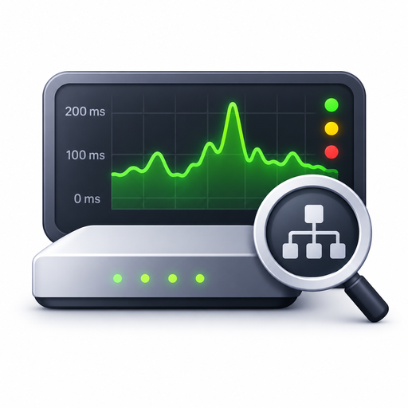
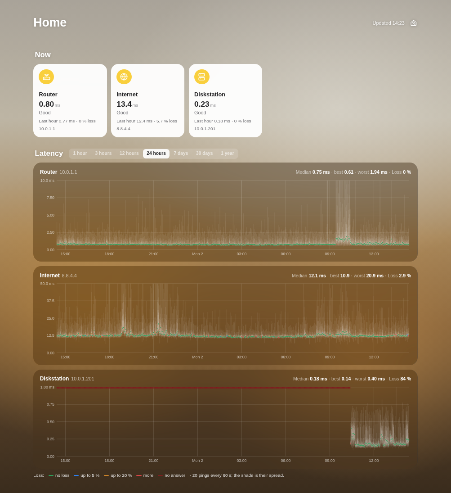
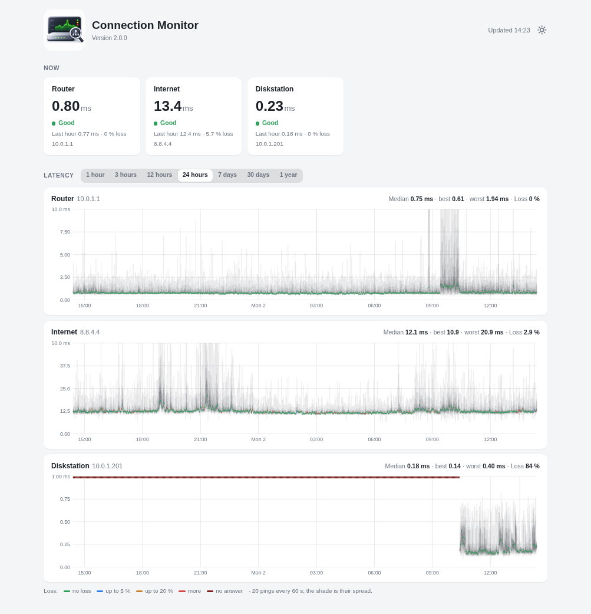
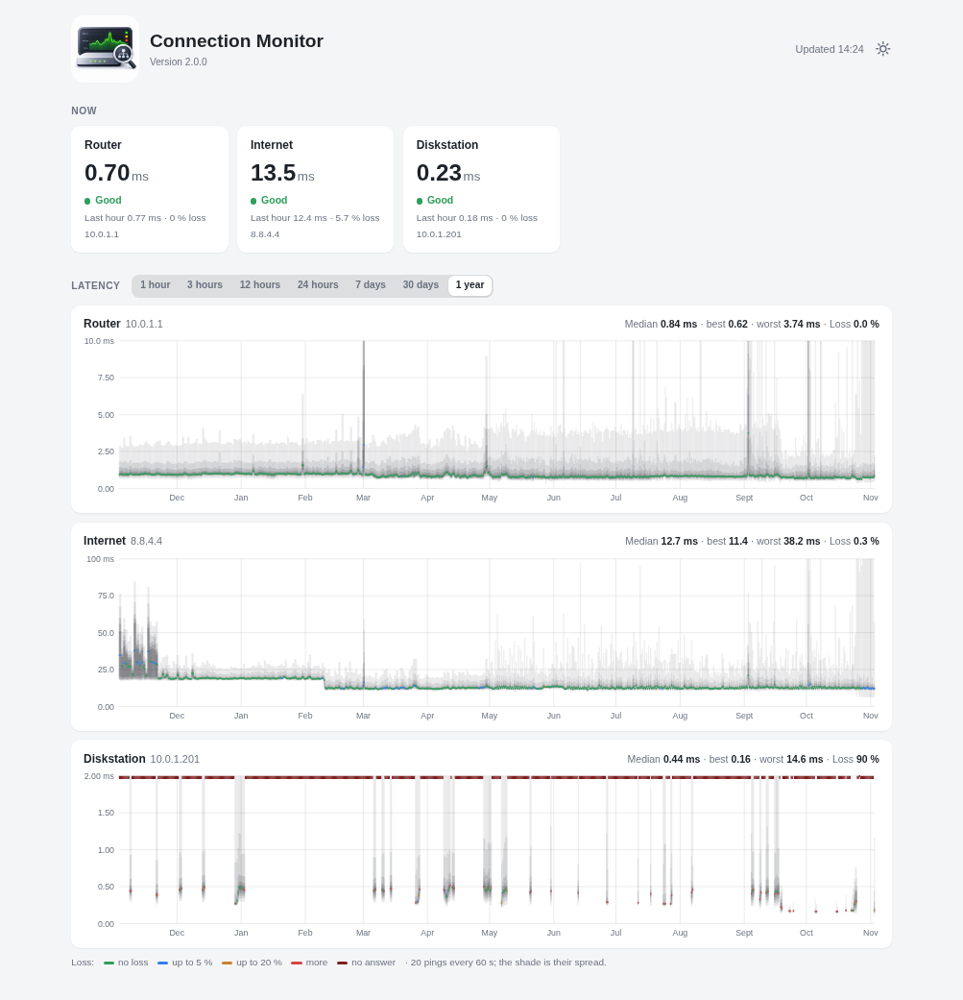
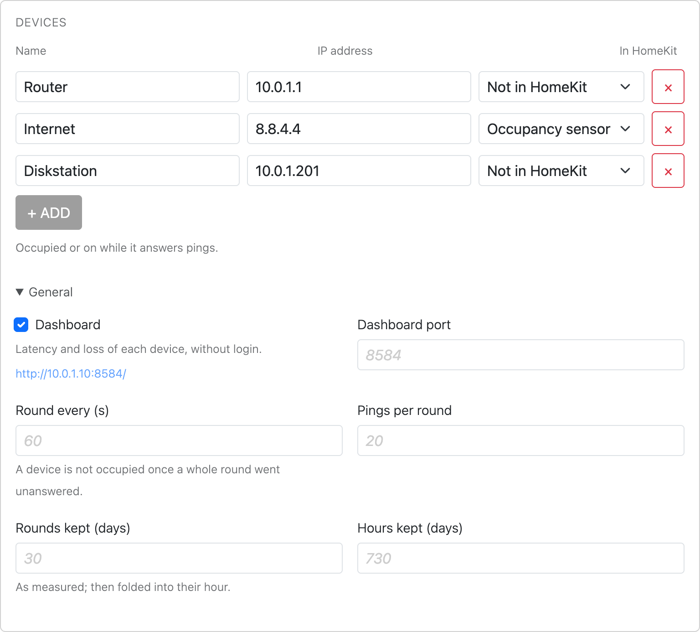

<p align="center">
  
</p>

<h1 align="center">homebridge-connection-monitor</h1>

<p align="center">
  Whether your <b>router</b>, the <b>internet</b>, a <b>phone</b> or anything else on your network <b>answers</b> &mdash; as an occupancy sensor, a switch or an outlet in the Apple Home app. And how fast, and how often it does not: <b>Smokeping</b>, on a dashboard in the Home look, with Smokeping's history taken over.
</p>

<p align="center">
  <a href="https://www.npmjs.com/package/homebridge-connection-monitor"></a>
  <a href="https://www.npmjs.com/package/homebridge-connection-monitor"></a>
  <a href="https://github.com/rummeyer/homebridge-connection-monitor/actions/workflows/build.yml"></a>
  <a href="https://github.com/rummeyer/homebridge-connection-monitor/blob/main/LICENSE"></a>
  
  
</p>

<p align="center">
  <a href="https://buymeacoffee.com/rummeyer"></a>
</p>

---

Give each device a **name** and its **IP address**, and it becomes an
**occupancy sensor** in HomeKit — or a switch or an outlet: **occupied, or
on, while it answers**, off once it stops. A phone that comes home, a NAS that was switched on, the
internet that went down — each one a trigger for an automation.

Every minute it sends each target **20 pings**, spread over the minute, as
Smokeping's FPing probe does, and keeps what came back. A **dashboard** shows
each target's latency and loss now, and its chart over **1 hour, 3 hours,
12 hours, 24 hours, 7 days, 30 days or a year** — drawn as Smokeping draws
it: the **median** a line coloured by loss, the **spread of the pings** the
smoke around it.

Nothing to install beside it: the pings go out through the system's own
`ping`, and the data is kept in **SQLite**, which comes with Node.

<p align="center">
  
</p>

## Contents

- [In the Home app](#in-the-home-app)
- [Dashboard](#dashboard)
- [Requirements](#requirements)
- [Installation](#installation)
- [Setting up](#setting-up)
- [Settings](#settings)
- [How it works](#how-it-works)
- [Coming from Smokeping](#coming-from-smokeping)
- [Coming from Connection Monitor 1](#coming-from-connection-monitor-1)
- [Troubleshooting](#troubleshooting)
- [Support](#support)
- [Credits](#credits)
- [Licence](#licence)

## In the Home app

Each device is an accessory of its own, named as the device — shown as its
**In HomeKit** setting chooses, as Appliance Monitor's *Running*:

| In HomeKit | |
|---|---|
| **Occupancy sensor** (default) | Occupied while it answers |
| **Switch** | On while it answers |
| **Outlet** | On, and in use, while it answers |
| **Not in HomeKit** | Still pinged, and on the dashboard |

All of them turn off once a whole round of pings went unanswered. A switch
or outlet only shows: switched in the Home app, it goes back a moment later.
Changing how a device is shown replaces it in HomeKit, with its automations.
On the dashboard every device is shown, its data kept by its name.

| | |
|---|---|
| **Occupied** / **on** | It answered — at once, from the first ping that comes back |
| **Not occupied** / **off** | A whole round of pings went unanswered |

A single lost ping never clears it: only a round of 20 without one answer
does, so a device has to be gone for a minute. One that comes back is seen
within a few seconds.

### Ideas for automations

- **Someone is home**: a phone's sensor turns occupied as it joins the Wi-Fi.
  Set its address to stay the same in the router, and keep in mind that a
  sleeping iPhone may not answer pings for a while.
- **The internet is down**: the sensor of `8.8.4.4` or `1.1.1.1` is not
  occupied — restart the router through a smart plug.
- **The NAS came on**: occupied — switch on what depends on it.

## Dashboard

At `http://<Homebridge machine>:8584/`, without a login, as it only reads.
The plugin's settings page links to it.

**A tile per target**: the median round-trip time of the last round, and
whether it is *Good*, losing pings, or giving *No answer* at all — with the
last hour beside it.

**A chart per target**, over 1 hour, 3, 12 or 24 hours, 7 or 30 days, or a
year:

- The **line** is the median, coloured by loss: green none, blue up to 5 %,
  orange up to 20 %, red more, dark red no answer at all.
- The **smoke** around it is the spread of the pings: the fastest and slowest
  tenth faintest, the middle fifth darkest. Wide smoke means jitter; a line
  without smoke, a steady connection.
- **Point at it** for the time, the median, where most pings were, and the
  loss.

**Three looks**, as Appliance Monitor's and Synology Monitor's dashboards:
Home, light and dark, switched by the button in the header. In the Home
look the smoke is a shadow on the glass and the lines are brighter, so the
median stands out from the wallpaper.

<p align="center">
  <picture>
    <source media="(prefers-color-scheme: dark)" srcset="https://raw.githubusercontent.com/rummeyer/homebridge-connection-monitor/main/docs/dashboard-dark.png">
    
  </picture>
  &nbsp;
  
</p>

## Requirements

- **Homebridge 2** and **Node.js 22.18, 24 or 26**
- **`ping`**, allowed to ping without root — as it is on Raspberry Pi OS,
  Debian, Ubuntu, macOS and in the Homebridge Docker image. Node cannot send
  pings itself, so the plugin runs the system's.

## Installation

Search for **Connection Monitor** under *Plugins* in the Homebridge UI and
install it, or:

```bash
npm install -g homebridge-connection-monitor
```

Run it as a **child bridge**, so that its pings never slow down the rest of
Homebridge: the plugin's bridge settings in the Homebridge UI, or
`"_bridge"` in config.json.

## Setting up

**1. The devices.** Open the plugin's settings in the Homebridge UI and
**+ Add** each device: a name, its IP address, and how it is in HomeKit. The router and a server on the internet, such
as `8.8.4.4`, are a good start.

<p align="center">
  <picture>
    <source media="(prefers-color-scheme: dark)" srcset="https://raw.githubusercontent.com/rummeyer/homebridge-connection-monitor/main/docs/settings-dark.png">
    
  </picture>
</p>

**2. Fixed addresses.** A device whose address changes is pinged at the wrong
one. Give each a fixed address in the router — on a FRITZ!Box, *Home
Network → Network → the device → Always assign this IPv4 address*.

**3. The Home app.** Add the child bridge with its code or QR code from the
Homebridge UI. Each device shown in HomeKit appears as an accessory.

```json
{
  "platform": "ConnectionMonitor",
  "name": "Connection Monitor",
  "targets": [
    { "name": "Router", "host": "192.168.1.1" },
    { "name": "Internet", "host": "8.8.4.4" },
    { "name": "Diskstation", "host": "192.168.1.20" },
    { "name": "Phone", "host": "192.168.1.50", "homekit": "switch" }
  ]
}
```

## Settings

| Setting | Default | |
|---|---|---|
| `targets` | none | The devices, each a `name`, a `host` — its IP address — and `homekit`: `occupancy` (default), `switch`, `outlet` or `none` |
| `stepSeconds` | `60` | Seconds between two rounds |
| `pings` | `20` | Pings per target and round, spread over nine tenths of the round |
| `dashboard` | `true` | Whether the dashboard is served |
| `port` | `8584` | The dashboard's port |
| `rawDays` | `30` | Days each round is kept as measured, before it is folded into its hour |
| `keepDays` | `730` | Days an hour is kept |

A device's name is what HomeKit and the dashboard call it, and what its data
is kept by: a new name starts afresh. Its icon on the dashboard is guessed
from the name and address — a router, the internet, a server or a device.

## How it works

Each round, the plugin runs `ping` once per target, all at once, so many
pings this far apart, and reads each answer as it comes. The first answer
sets the sensor occupied; a round without one clears it.

Everything is kept in one SQLite file, `connection-monitor/connection-monitor.db`
in Homebridge's storage folder — `/var/lib/homebridge` on a Raspberry Pi
with the Homebridge image — as Appliance Monitor keeps its own. Each round,
its pings' times and how many were lost, is kept as measured for 30 days,
then folded into its hour, which keeps the quantiles of all its pings, so
the smoke of a year-old hour is still its own. Three targets take a few tens
of megabytes.

The dashboard asks two things, both read only:

| | |
|---|---|
| `GET /api/status` | Every target: its last round, its last hour and its last day |
| `GET /api/series?target=Router&range=24h` | A target's chart, `1h`, `3h`, `12h`, `24h`, `7d`, `30d` or `1y`, as points with the median, loss and the quantiles of the pings |

## Coming from Smokeping

On the machine Smokeping runs on, as the user Homebridge runs as:

```bash
sudo -u homebridge connection-monitor-import
```

It reads Smokeping's targets from `/etc/smokeping/config.d/Targets` and each
one's RRD from `/var/lib/smokeping` — five minutes for the last three and a
half days, hours for half a year, twelve hours for a year — through Perl's
RRDs module, which Smokeping itself uses, so `rrdtool` need not be
installed. Other places:

```bash
sudo -u homebridge connection-monitor-import --targets /path/to/Targets --data /path/to/rrds --storage /var/lib/homebridge
```

Then add the targets in the plugin's settings under the **same names**. For
each stretch the charts take the finest there is: the plugin's minutes where
it has them, Smokeping's five minutes, hours or half days before that. Run
again — say right after stopping Smokeping, for its last minutes — it
replaces what it took before and leaves what was measured since.

## Coming from Connection Monitor 1

Connection Monitor 1 ran on its own with fping and a `config.json`. Its data
goes on as it was:

1. Stop it: `sudo systemctl disable --now connection-monitor`
2. Copy its database into Homebridge's storage folder:
   ```bash
   sudo install -d -o homebridge -g homebridge /var/lib/homebridge/connection-monitor
   sudo install -o homebridge -g homebridge -m 644 data/connection-monitor.db /var/lib/homebridge/connection-monitor/
   ```
3. Add its targets in the plugin's settings under the same names and
   addresses; an `icon` is no longer set, it is guessed.

fping is no longer needed.

## Troubleshooting

**A sensor is never occupied, and the log says `ping could not run`**: there
is no `ping` on the Homebridge machine. The plugin looks for it in `/bin`,
`/sbin`, `/usr/bin` and `/usr/sbin`, then on the `PATH`. Install it
(`sudo apt install iputils-ping`).

**`Operation not permitted`** in the log: `ping` may not ping without root
here. On Linux, `sudo setcap cap_net_raw+ep $(which ping)`.

**A phone flips between occupied and not**: phones sleep their Wi-Fi and
skip pings. A whole minute without an answer clears the sensor; set
`stepSeconds` higher for a longer one.

**The dashboard does not open**: is **Dashboard** ticked, and the child
bridge restarted since? The log says `Dashboard on port 8584` when it is up,
or why the port could not be used.

## Support

Questions and bugs: [GitHub issues](https://github.com/rummeyer/homebridge-connection-monitor/issues).
When something does not work, the log lines of the child bridge help most.

If the plugin is useful to you, you can support its development:

<p>
  <a href="https://buymeacoffee.com/rummeyer"></a>
</p>

The Homebridge UI shows the same link behind the plugin's **Donate** button.

## Credits

Connection Monitor owes its idea and its look to
[**Smokeping**](https://oss.oetiker.ch/smokeping/) by **Tobias Oetiker**:
the pings sent in rounds as its FPing probe sends them, the median drawn as a
line coloured by loss, and the spread of the pings as the smoke around it.
None of Smokeping's code is in it — it is written anew for Homebridge — but
without Smokeping it would not look the way it does. Taking over its
history reads its RRD files with the RRDs Perl module Smokeping itself uses.

Thank you, Tobias, and everyone who has worked on Smokeping.

## Licence

MIT
